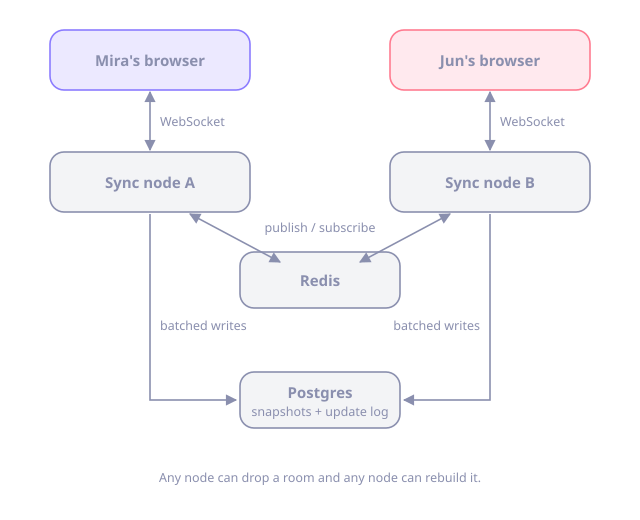

# SyncCode

A real-time collaborative code editor. Open a room, share the link, and edit the same file together
with live cursors. Built to learn (and be able to explain) CRDTs, WebSocket scaling and realtime
persistence end to end.

> I built a horizontally scaled WebSocket backend where multiple stateless sync nodes share per-room
> document state over Redis pub/sub, with Yjs CRDTs guaranteeing convergence regardless of which node
> a client lands on.



## What it does

- **Real-time multi-user editing.** Yjs CRDT over a compact binary WebSocket protocol.
- **Horizontal scaling.** Any number of identical sync nodes; rooms are shared over Redis pub/sub
  with echo suppression. No sticky sessions, no sharding config.
- **Presence.** Live cursors, selections, names and avatars through the awareness protocol.
- **Persistence.** Append-only `bytea` update log in Postgres, periodically compacted into snapshots.
- **Cheap reconnection.** State-vector handshake: a client that was offline catches up with one diff.
- **Share links.** HMAC capability tokens in the URL fragment: one link to edit, one to watch.
- **Operations.** Graceful shutdown, heartbeats, backpressure guard, `/healthz`, `/readyz`, `/metrics`.

## Repository layout

```
apps/sync        WebSocket sync server (Hono + ws). Class-based: one class, one responsibility.
apps/web         Next.js 15 UI. Functional React, hooks, Zustand.
packages/shared  The wire contract: frame codec, message types, zod schemas, colour palette.
packages/db      Drizzle schema, migrations, createDb().
docker           Multi-node demo: nginx → sync-a + sync-b → redis + postgres.
scripts          seed-rooms, compact-snapshots, load-test.
docs             architecture.md, crdt-notes.md, scaling-walkthrough.md
```

## Run it locally

Requirements: Node 22+, pnpm, Postgres 14+, Redis 6+.

```bash
pnpm install
cp .env.example .env            # set DATABASE_URL and REDIS_URL; replace EDIT_SECRET with: openssl rand -hex 32
createdb synccode               # or point DATABASE_URL at any empty database
pnpm db:migrate                 # reads the root .env
pnpm dev                        # sync node on :4000, web on :3000
```

Open <http://localhost:3000>, start a room, and open the link in a second window.
<http://localhost:3000/engineering> explains the backend visually: an animated walk through one
keystroke, a live two-replica CRDT demo, the protocol, and the test that proves each claim.

`pnpm seed` creates three rooms with starter code and prints their edit and view links.

### The multi-node demo

```bash
docker compose -f docker/docker-compose.yml up --build
```

This starts nginx (round-robin) in front of two sync nodes, plus Redis, Postgres and the web UI on
<http://localhost:3000>. Open one room in two tabs: the status bar names the node each tab landed on
(`Node sync-a` / `Node sync-b`), and both tabs still show the same document. Stop one node with
`docker compose stop sync-a` and its clients reconnect to the other without losing anything.

Without Docker, start two nodes by hand:

```bash
PORT=4000 NODE_NAME=sync-a pnpm dev:sync
PORT=4001 NODE_NAME=sync-b pnpm dev:sync
```

## Tests

| Command                        | What runs                                                             |
| ------------------------------ | --------------------------------------------------------------------- |
| `pnpm test`                    | Unit, integration and two-node protocol tests (Vitest)                |
| `pnpm test:e2e`                | Browser tests (Playwright); needs `pnpm dev` running                  |
| `pnpm lint` / `pnpm typecheck` | Biome, strict TypeScript                                              |
| `pnpm load-test`               | N headless clients on one room; reports p50/p95/p99 broadcast latency |

Integration tests need a real Postgres and Redis. By default they start both with Testcontainers
(Docker required). To use instances you already have:

```bash
TEST_DATABASE_URL=postgres://localhost:5432/synccode_test TEST_REDIS_URL=redis://localhost:6379 pnpm test
```

The file to read first is [`apps/sync/test/e2e-protocol/convergence.test.ts`](apps/sync/test/e2e-protocol/convergence.test.ts):
two in-process sync nodes, one Postgres, one Redis, clients on different nodes, documents must converge.

### Measured

Local machine, two sync nodes (dev build), 50 clients split across both, 2 edits/s each for 10 s:

```
edits sent          997
deliveries observed 48853 of ~48853
converged           yes: all replicas identical
broadcast latency   p50 1.7 ms | p95 4.4 ms | p99 6.1 ms | max 8.6 ms
```

Reproduce with `SYNC_URLS=ws://localhost:4000,ws://localhost:4001 pnpm load-test`. Cold-start time
(loading a room from Postgres) is exported as the `synccode_room_hydration_seconds` histogram on `/metrics`.

## Configuration

| Variable                                          | Used by          | Default                      | Purpose                                            |
| ------------------------------------------------- | ---------------- | ---------------------------- | -------------------------------------------------- |
| `DATABASE_URL`                                    | sync             | required                     | Postgres connection string                         |
| `REDIS_URL`                                       | sync             | required                     | Redis connection string                            |
| `EDIT_SECRET`                                     | sync             | required                     | 32 bytes hex; keys the stored edit-token hashes    |
| `PORT`                                            | sync             | `4000`                       | HTTP + WebSocket port                              |
| `LOG_LEVEL`                                       | sync             | `info`                       | Pino level                                         |
| `NODE_NAME`                                       | sync             | first 8 chars of the node id | Label in logs and in the UI status bar             |
| `ALLOWED_ORIGINS`                                 | sync             | `*`                          | Comma-separated browser origins allowed to connect |
| `RUN_MIGRATIONS`                                  | sync             | `false`                      | Apply migrations at boot (one node only)           |
| `FLUSH_INTERVAL_MS`                               | sync             | `500`                        | Debounce for batched update writes                 |
| `IDLE_EVICTION_MS`                                | sync             | `300000`                     | How long an empty room stays in memory             |
| `COMPACTION_INTERVAL_MS` / `COMPACTION_THRESHOLD` | sync             | `60000` / `1000`             | Snapshot schedule and trigger                      |
| `HEARTBEAT_INTERVAL_MS`                           | sync             | `30000`                      | WebSocket ping interval                            |
| `MAX_BUFFERED_BYTES`                              | sync             | `4194304`                    | Backpressure limit per socket                      |
| `NEXT_PUBLIC_SYNC_WS_URL`                         | web (build time) | `ws://localhost:4000`        | Where browsers open WebSockets                     |
| `SYNC_HTTP_URL`                                   | web (server)     | `http://localhost:4000`      | Where Next.js calls the sync HTTP API              |

The sync server validates its environment at boot and refuses to start with a clear list of what is wrong.

## Deployment

- **Web** → Vercel. Root directory `apps/web`; set `NEXT_PUBLIC_SYNC_WS_URL` (`wss://…`) and `SYNC_HTTP_URL`.
- **Sync** → Koyeb (or Fly/Render) from `apps/sync/Dockerfile`, build context = repo root.
  Set `DATABASE_URL`, `REDIS_URL`, `EDIT_SECRET`, `ALLOWED_ORIGINS`.
- **Postgres** → Neon. `pnpm db:migrate` runs in CI on `main` once the `DATABASE_URL` secret exists.
- **Redis** → Upstash.

Honest note: a hosted demo on free tiers runs **one** sync node, because free tiers do not keep two
long-lived WebSocket services up comfortably. The horizontal-scaling design is proven locally (the
compose demo and the convergence test), not by the hosted demo.

## Where the build departs from the design document

Each of these was a deliberate fix for a problem found while building, not an omission.

| Design document                                                    | What was built                                                                                         | Why                                                                                                                                                         |
| ------------------------------------------------------------------ | ------------------------------------------------------------------------------------------------------ | ----------------------------------------------------------------------------------------------------------------------------------------------------------- |
| Client sends `SYNC_STEP_1` on open                                 | Server sends `AUTH_ACK` first; the client syncs after it                                               | `roomRef` is assigned by the server, so the client cannot address a frame before it has been told its `roomRef`                                             |
| Envelope kinds `update`, `awareness`                               | A third kind, `sync-request`                                                                           | A node loading a room cold can miss edits that are in another node's memory but not yet flushed. It now asks peers for the diff                             |
| Compaction snapshots the in-memory doc and deletes by `created_at` | Snapshot is rebuilt from Postgres up to a fixed row id, inside one transaction, under an advisory lock | The in-memory doc may lack another node's rows; timestamps from several writers are not a safe cut. Covered by a concurrent write/compact test              |
| Hydrator replays updates since the snapshot's timestamp            | Replays every remaining row (keyset-paginated by id)                                                   | Same reason; updates are idempotent and compaction prunes what a snapshot covers                                                                            |
| `@monaco-editor/react`                                             | Monaco mounted directly via `useMonacoEditor`                                                          | The wrapper disposes its editor in an effect cleanup and does not recreate it when React re-runs effects (StrictMode, Fast Refresh), which crashed the page |
| `useYjsDoc` creates the doc during render                          | Created inside the effect                                                                              | The sketch destroys the doc on the StrictMode double-mount and then keeps using it                                                                          |
| `edit_token_hash`                                                  | Keyed hash: `HMAC(EDIT_SECRET, slug + ':' + token)`                                                    | This is what `EDIT_SECRET` is for; a leaked table cannot be brute-forced offline                                                                            |
| Language stored on the room row                                    | Stored in a shared `Y.Map` and mirrored to the row                                                     | A language change has to reach the other editors in real time                                                                                               |
| `tailwind.config.ts`, `og.png`                                     | Tailwind v4 CSS tokens in `globals.css`; `opengraph-image.tsx`                                         | Tailwind v4 configures in CSS; the OG image is generated at build                                                                                           |

Versions follow the document where it names one (TypeScript 5, Next.js 15, React 19, Zod 3, Tailwind 4, ws 8).

## Not built

User accounts, code execution, LSP, multi-file projects, rate limiting on `POST /rooms` (see the
design document's non-goals). Still to do by hand: provision Vercel/Koyeb/Neon/Upstash, and record
the screencast of the multi-node demo.

## Further reading

- [docs/architecture.md](docs/architecture.md) — components, protocol, data model
- [docs/crdt-notes.md](docs/crdt-notes.md) — how Yjs/YATA converges, state vectors, awareness
- [docs/scaling-walkthrough.md](docs/scaling-walkthrough.md) — one update's journey across two nodes
